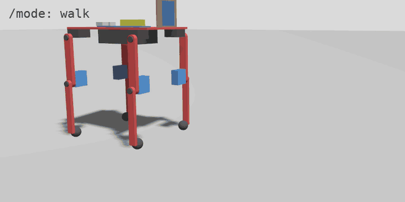
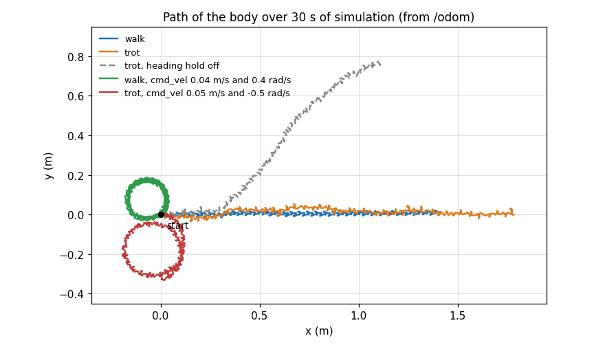

# robot-dog-ros2-sim

The 8-servo robot dog from my Robotics course project (ME 604), simulated in Gazebo with ROS 2
Jazzy. Like the course robot, it walks, turns, stands and sits. It also trots, holds its heading
with an IMU and follows a figure-8 round two posts. A C++ gait node works out where each foot
should be, solves the leg inverse kinematics and sends the 8 joint angles to ros2_control.




The course robot, built by a 6-member team, walked on servo angles tuned by hand, pose by pose.
This simulation was written in 2026, after the course. It makes the gait from foot paths instead,
with the leg kinematics from my `leg-ik-gait` repo.

## The model

From the course robot:

- body 150 x 97.5 mm
- four legs, each with a 67 mm femur and a 75 mm tibia
- an MG90S servo at every hip and knee, 8 in all, simulated with a 0.2 N m torque limit and a
  10 rad/s speed limit, close to the servo's datasheet values
- the look, from photos of the robot: the red printed plate and leg brackets, the hip and knee
  servos, the battery holders under the plate, the power board, the 16-channel servo driver and
  the ESP8266 on a board at the front

Physics uses simple shapes: a box for the body and a ball of 8 mm radius for each foot, with a
friction coefficient of 1. Estimated: the masses (0.30 kg for the body with the electronics,
batteries and hip servos, and 35 g per leg, 0.44 kg in all) and the positions of the hips.

## How it works

```
/odom --> path_node --+  /cmd_vel: speed and turn rate (or the keyboard)
                      |
                      v
/imu ------------> gait_node --> 8 joint angles, 50 Hz --> leg_controller --> Gazebo
                      ^                                    (ros2_control)
/mode (walk, stand, sit)
```

- **Gait node** (`src/gait_node.cpp`). Every 20 ms it takes the gait phase of each leg, works out
  where the foot should be, and turns that into hip and knee angles with closed-form inverse
  kinematics (law of cosines and atan2, in `include/robot_dog_sim/leg.hpp`).
- **Foot path.** On the ground (stance) a foot moves back in a straight line, which pushes the body
  forward. In the air (swing) it moves forward, up and down again on cosine curves, so it lifts off
  and touches down with no vertical speed. leg-ik-gait lifted the foot on a half sine, which leaves
  and meets the ground at full vertical speed. In one 30 s run of each, the cosine swing made the
  walk bounce less (the standard deviation of the body height fell from 1.0 to 0.6 mm) and 4 %
  faster, and the trot 10 % faster with the same bounce (2.4 mm).
- **Two gaits.** The walk lifts one leg at a time (rear left, front left, rear right, front right),
  so three feet are always on the ground, with a 0.8 s cycle. The trot moves the diagonal pairs
  together, with a 0.35 s cycle.
- **Speed and turning.** For feet that do not slip, body speed = stride / time on the ground, so
  the node sets the stride to speed x duty factor x cycle time. To turn, the left and right legs
  take different strides and the feet skid round, since a 2-joint leg cannot step sideways. If a
  stride would pass the 6 cm limit, both sides shrink by the same factor, so the dog keeps its
  curve.
- **Heading hold.** While no turn is asked for, a proportional controller steers back to the
  heading the dog had when the last turn ended, using the yaw from the IMU. The turn command is
  smoothed, so right after a turn the dog swings a little past that heading before it comes back.
- **Stand and sit.** Like the course robot, the dog can stand still and sit. Send `walk`, `stand`
  or `sit` on `/mode` (a `std_msgs/String`). Each change moves every foot in a straight line to
  the new pose in 1 s, starting and ending slowly, like a smooth keyframe. Sitting bends every leg
  more than standing, the rear legs most (rear feet 4 cm under the hips, front feet 9 cm), so the
  body tilts back. A walk always starts from standing.
- **Path node** (`src/path_node.cpp`). It walks the dog round the waypoints in `config/path.yaml`,
  16 points on two circles of 25 cm radius. It reads the body's position and heading from `/odom`,
  turns towards the next waypoint (turn rate = 1.5 x heading error, at most 0.4 rad/s) and walks
  slower the more it faces away from it (speed x cos(error)). Within 6 cm of a waypoint it moves
  on to the next one.
- **ros2_control.** gz_ros2_control runs the controller manager inside Gazebo. `leg_controller`, a
  JointGroupPositionController, takes the 8 angles, and `joint_state_broadcaster` publishes
  `/joint_states` with the angle, speed and torque of every joint.

## Results

**Straight and turning.** One 30 s run of each, measured on `/odom` (the body's true position in
Gazebo) from second 10 to second 30. Measured speed is the straight-line distance between the two
positions divided by 20 s, and the turn rate is the change of heading over the same 20 s.

| Run | Commanded | Measured | Largest offset from the start line | Largest tilt |
|---|---|---|---|---|
| walk | 0.06 m/s | 0.053 m/s | 2.1 cm | 8.1° |
| trot | 0.08 m/s | 0.067 m/s | 5.3 cm | 9.3° |
| trot, heading hold off | 0.08 m/s | 0.062 m/s | 77 cm | 9.3° |
| walk, turning left | 0.4 rad/s | 0.355 rad/s | | |
| trot, turning right | 0.5 rad/s | 0.335 rad/s | | |



With heading hold the dog covers 84 to 88 % of the commanded speed. Without it the trot wanders
off its line, so its straight-line speed is lower. The stride formula assumes feet that stay
planted, and in the simulation part of each stride is lost to feet slipping or landing early while
the body rocks. I have not measured which. The trot turns at two thirds of the commanded rate.

**Figure-8.** One 150 s run of each gait with `path.launch.py`, two loops each. Distance of the
body from the two circles of the figure-8, after the first 10 s:

| Gait | Mean | 95 % of the time within | Largest |
|---|---|---|---|
| walk | 28 mm | 58 mm | 79 mm |
| trot | 24 mm | 72 mm | 104 mm |

One loop of the figure-8 takes about 65 s in the walk. The body centre never came closer than
17 cm to the centre of a post.

**Sitting.** The body tilts back by 22.6° and its centre drops from 108 to 68 mm above the floor.
It stays still there, and the largest joint torque while sitting is about 0.12 N m, within the
0.2 N m servo limit.

## Run it

Needs Ubuntu 24.04 with ROS 2 Jazzy, Gazebo Harmonic and these packages:

```bash
sudo apt install ros-jazzy-ros-gz ros-jazzy-gz-ros2-control ros-jazzy-ros2-controllers ros-jazzy-xacro ros-jazzy-teleop-twist-keyboard
```

Build it in a workspace:

```bash
source /opt/ros/jazzy/setup.bash
mkdir -p ~/dog_ws/src
cp -r robot-dog-ros2-sim ~/dog_ws/src/
cd ~/dog_ws
colcon build
source ~/dog_ws/install/setup.bash
```

If a real robot runs ROS 2 on the same network, or another simulation runs on this PC, keep this
one apart first. The first two lines keep its ROS 2 traffic on this PC, so its `/cmd_vel` cannot
reach a robot. The last two do the same for Gazebo's own messages.

```bash
export ROS_DOMAIN_ID=7
export ROS_AUTOMATIC_DISCOVERY_RANGE=LOCALHOST
export GZ_PARTITION=robot_dog
export GZ_IP=127.0.0.1
```

Start it:

```bash
ros2 launch robot_dog_sim sim.launch.py               # walk straight ahead
ros2 launch robot_dog_sim sim.launch.py gait:=trot    # trot
ros2 launch robot_dog_sim path.launch.py              # figure-8 round two posts
ros2 launch robot_dog_sim path.launch.py gait:=trot   # the same, trotting
```

The dog stands for 2 s, then starts. In the Gazebo window, right-click the dog and pick Follow.
robot_state_publisher warns that KDL does not support a root link with an inertia. That is
expected: KDL only builds the TF tree, and Gazebo still uses the inertia.

To steer it yourself, start `sim.launch.py`, then run this in a second terminal (after the same
`source ~/dog_ws/install/setup.bash` and `export` lines) and use the keys it lists:

```bash
ros2 run teleop_twist_keyboard teleop_twist_keyboard --ros-args -p speed:=0.06 -p turn:=0.4
```

It starts at 0.06 m/s and 0.4 rad/s. The strides are limited to 6 cm, which caps the walk at
0.1 m/s.

To make it stand, sit and walk again:

```bash
ros2 topic pub --once /mode std_msgs/msg/String "{data: stand}"
ros2 topic pub --once /mode std_msgs/msg/String "{data: sit}"
ros2 topic pub --once /mode std_msgs/msg/String "{data: walk}"
```

More:

```bash
ros2 topic echo /odom --field pose.pose.position        # where the body is
ros2 launch robot_dog_sim sim.launch.py gui:=false       # without the Gazebo window
colcon test --packages-select robot_dog_sim && colcon test-result --verbose
```

The settings of each gait are in `config/walk.yaml` and `config/trot.yaml`: cycle time, speed,
hip height above the centre of the foot ball, step height and heading gain. The waypoints are in
`config/path.yaml`. After changing one, run `colcon build` again, since the launch files read the
installed copy.

## Files

| File | What it is |
|---|---|
| `include/robot_dog_sim/leg.hpp` | leg inverse kinematics and foot path |
| `src/gait_node.cpp` | the gait node: walk, trot, stand and sit |
| `src/path_node.cpp` | the path node |
| `urdf/robot_dog.urdf.xacro` | the robot: links, joints, servo limits, ros2_control, IMU, look |
| `config/controllers.yaml` | the two controllers and the servo gain |
| `config/walk.yaml`, `config/trot.yaml` | gait settings |
| `config/path.yaml` | waypoints of the figure-8 |
| `launch/sim.launch.py` | starts Gazebo, the controllers and the gait node |
| `launch/path.launch.py` | `sim.launch.py` in the course world, plus the path node |
| `worlds/floor.sdf`, `worlds/course.sdf` | a flat floor, and the same floor with two posts |
| `test/test_leg.cpp` | unit tests for the leg maths |

## Limits

- Two joints per leg, so the feet cannot move sideways. Turning works by skidding.
- Only the heading is closed-loop. Nothing levels the body, which rolls and pitches by up to
  about 9°. In the trot the heading still swings by up to about 20° either way within each step,
  and the hold keeps only the average heading.
- The heading comes from the orientation of Gazebo's IMU, which does not drift. The yaw from a
  real IMU drifts, so a real robot would need a magnetometer or another heading source.
- The path node uses Gazebo's true position from `/odom`. A real robot would have to estimate its
  position, for example from leg odometry, the IMU and a camera.
- The simulated servo is a position controller with torque and speed limits, not a model of the
  MG90S's own control loop.
- The masses and the hip positions are estimates.
