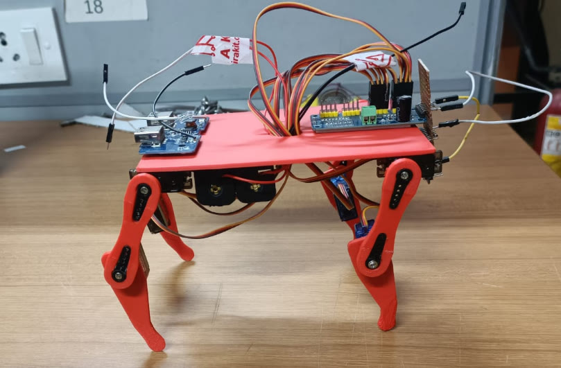
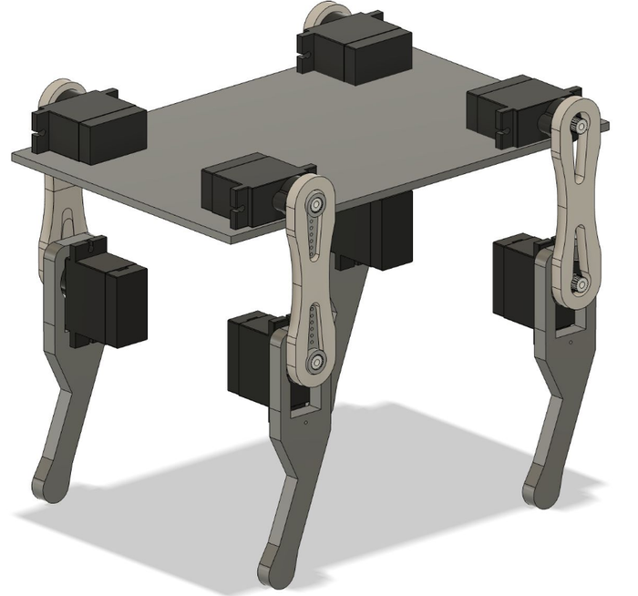
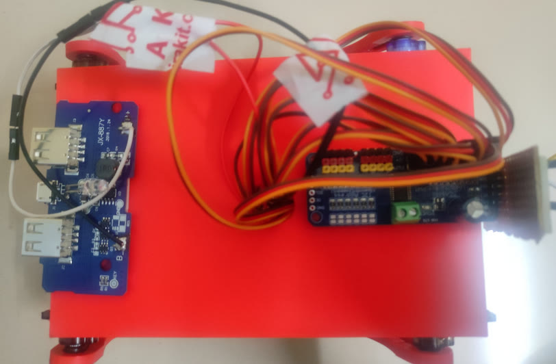
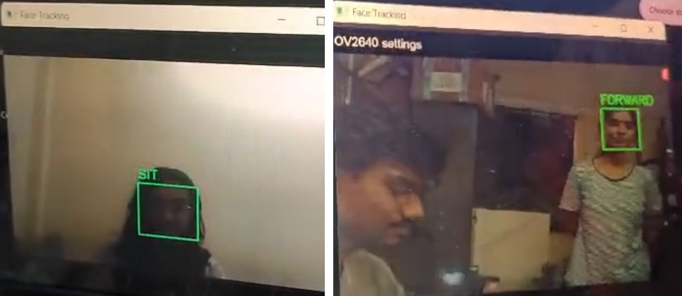
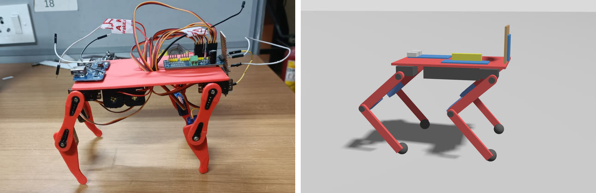
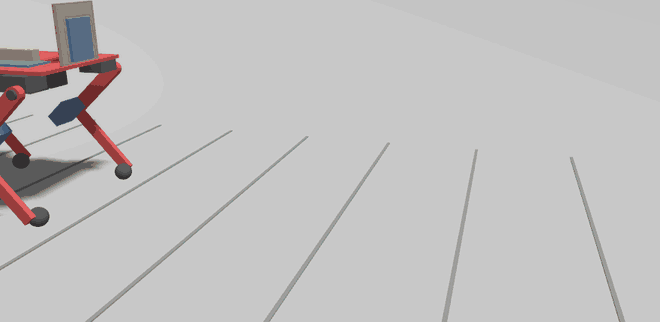
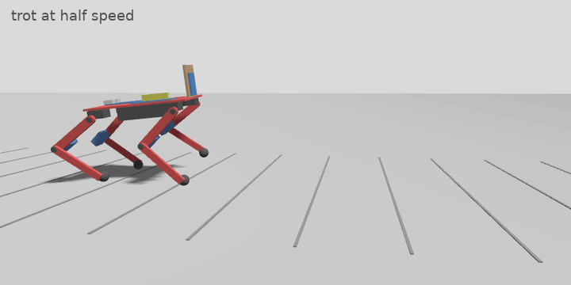
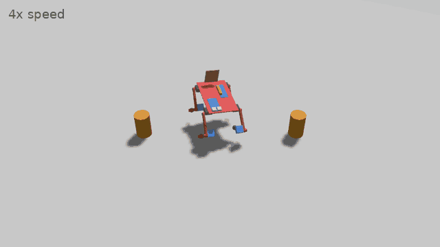
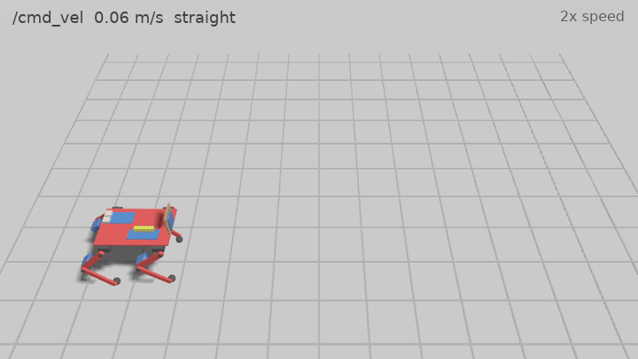

# Quadruped robot dog

An 8-servo robot dog that walks, turns, stands and sits, and takes moves from the position of a
face in a live camera stream.

The robot: course project, Robotics (ME 604), IIT Bombay, Jan 2025 to Apr 2025, in a 6-member
team. Guide: Prof. Abhishek Gupta. The simulation in [`ros2_sim/`](ros2_sim/) came later, in
2026. I made it after the course, and it was not part of the course.

*The course robot (photo from the team's course slides, 2025).*

## The robot

Each of the four legs has an MG90S servo at the hip and one at the knee, so the robot has 8 servos
and 2 DOF per leg. The body chassis was designed in CAD and 3D-printed. An ESP8266 runs the robot
and takes move commands over Wi-Fi.

  
  

*Left: the CAD model, with a servo at each hip and knee. Right: the top of the robot, with a power
board and the 16-channel servo driver (CAD screenshot and photo from the team's course slides,
2025).*

## What I did

- **Firmware.** I wrote the C++ firmware for the ESP8266 in the Arduino IDE. Walking and turning
  use servo keyframes that were tuned by hand.
- **Poses.** I added standing and sitting poses. Every leg bends through a greater angle when
  sitting than when standing.
- **Camera.** I streamed live video from an ESP32-S3 camera. Face detection with an OpenCV Haar
  cascade ran on a PC, by screen capture.
- **Face to move.** I mapped the face position to a move and sent it to the ESP8266 by HTTP GET.
  Face above the centre: walk forward. At the centre: stand. Below the centre: sit.
- **Cooldown.** I added a command cooldown in the vision loop, so the same move was never sent to
  the ESP8266 twice within 5 s.

*Face tracking on the PC. A face low in the camera picture gives SIT, a face high in it gives
FORWARD (team photos of the screen, 2025).*

## Hardware

| Part | Used |
|---|---|
| Controller | ESP8266 |
| Servos | 8 x MG90S, hip and knee on each leg |
| Servo driver | 16-channel PWM servo driver board |
| Power | power board on top, batteries under the plate |
| Body | chassis designed in CAD and 3D-printed, 150 x 97.5 mm |
| Legs | 67 mm femur and 75 mm tibia on each leg |
| Camera | ESP32-S3 camera, live video stream |
| Vision | OpenCV Haar-cascade face detection on a PC |

The original firmware is not in this repo.

## The simulation, written in 2026 (`ros2_sim/`)

After the course I modelled the same robot in Gazebo with ROS 2 Jazzy: its body and leg sizes, its
8 servos and its look. Like the course robot, it walks, turns, stands and sits. It also trots,
holds its heading with an IMU and follows a figure-8 round two posts. A C++ gait node works out
where each foot should be, solves the leg inverse kinematics and sends the 8 joint angles to
ros2_control. The course robot walked on servo angles tuned by hand, pose by pose. The simulation
makes the gait from foot paths instead.

*Left: the course robot (photo from the team's course slides, 2025). Right: the Gazebo model
(2026), with the course robot's body and leg sizes and its look.*

*The walk in Gazebo, real time. The floor marks every 10 cm were added for the recording.*

*The trot at half speed. Diagonal legs move together, 0.35 s per cycle.*

*A figure-8 round two posts, 4 times real speed, with the path of the body drawn in.*

*Walk, stand, sit, stand and walk again, each sent on the `/mode` topic.*

*Steering on `/cmd_vel` at 2 times real speed: straight, a left turn, straight, a right turn,
straight, with both turns sent as 0.4 rad/s. The blue line is the body's path from `/odom`, over
a 10 cm floor grid added for the recording.*

In one 30 s run of each, the walk moved at 0.053 m/s for a commanded 0.06 m/s and the trot at
0.067 m/s for 0.08 m/s. On the figure-8 the body was on average 28 mm from the circles in the
walk and 24 mm in the trot. How it works, all the results and how to run it are in
[ros2_sim/README.md](ros2_sim/README.md).

## Related repo

- [leg-ik-gait](https://github.com/vedmunj-iitb/leg-ik-gait), written in 2026 after the course and
  separate from the course robot's firmware: inverse kinematics and a gait generator in C++ for a
  leg with two joints (hip and knee), like this robot's. The simulation in `ros2_sim/` uses its
  leg maths.

## Licence

The code in `ros2_sim/` is under the MIT licence in `LICENSE`. The course team's photos and CAD
picture in `photos/`, taken from its 2025 slides, are not covered by it.
